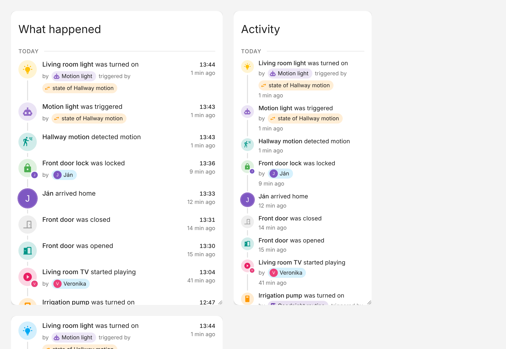

# What Happened Card

[](https://hacs.xyz)
[](https://github.com/jan-tdy/ha-what-happened-card/actions/workflows/ci.yml)

A live, resizable timeline for Home Assistant that tells you **what happened, when, why and who or what caused it**.



> Living room light was turned on — by **Motion light** — triggered by **state of Hallway motion**

## Features

- Live vertical timeline built on the Home Assistant logbook, with day headers and clock/relative times.
- Explains the cause using Home Assistant context: person (with profile picture), automation, script, scene, service call or another entity, plus the trigger that started it.
- Choose **how many** entries (1 – 500) and **how far back** (1 – 720 hours).
- Limit to areas, floors, devices, labels or entities; exclude entities or domains.
- Resizable in Sections views (drag handles), `max_height` for Masonry/Panel views.
- Full visual editor, follows your theme (light/dark), keyboard accessible.

## Installation

### HACS

1. HACS → Frontend → ⋮ → **Custom repositories** → add `https://github.com/jan-tdy/ha-what-happened-card`, category **Dashboard**.
2. Install **What Happened Card** and reload the browser.

### Manual

Download `what-happened-card.js` from the latest release, put it in `config/www/` and add it as a dashboard resource (`/local/what-happened-card.js`, type _JavaScript module_).

## Usage

Add the card from the card picker (**What Happened**) or in YAML:

```yaml
type: custom:what-happened-card
title: What happened
hours_to_show: 24
max_entries: 50
target:
  area_id:
    - living_room
exclude_domains:
  - automation
```

## Options

| Option             | Default        | Description                                                               |
| ------------------ | -------------- | ------------------------------------------------------------------------- |
| `title`            | –              | Card title                                                                |
| `hours_to_show`    | `24`           | Time window, 1 – 720 hours                                                |
| `max_entries`      | `50`           | Maximum entries, 1 – 500                                                  |
| `order`            | `newest_first` | `newest_first` or `oldest_first`                                          |
| `target`           | all            | `entity_id`, `device_id`, `area_id`, `floor_id`, `label_id` (string/list) |
| `exclude_entities` | –              | Entities to hide                                                          |
| `include_domains`  | –              | Only show these domains                                                   |
| `exclude_domains`  | –              | Hide these domains                                                        |
| `show_cause`       | `true`         | Show who/what caused it and the trigger                                   |
| `show_avatars`     | `true`         | Use profile pictures for people                                           |
| `show_day_headers` | `true`         | Group by day                                                              |
| `colorful`         | `true`         | Colored accents per domain                                                |
| `compact`          | `false`        | Smaller layout                                                            |
| `time_display`     | `both`         | `both`, `absolute` or `relative`                                          |
| `tap_action`       | `more-info`    | `more-info` or `none`                                                     |
| `max_height`       | –              | Pixels; for Masonry/Panel views                                           |
| `hide_unavailable` | `true`         | Hide `unavailable` / `unknown` states                                     |
| `collapse_repeats` | `true`         | Merge rapid repeats of the same event (shown as ×N)                       |

The "why" comes from the Home Assistant logbook context. Changes made physically on a device have no context, so they show without a cause line.

## Development

```bash
npm ci
npm test          # unit tests
npm run typecheck
npm run build     # dist/what-happened-card.js
npx vite          # dev harness at http://localhost:5173/dev/index.html
```

Requires Home Assistant 2024.8 or newer.

## License

MIT
